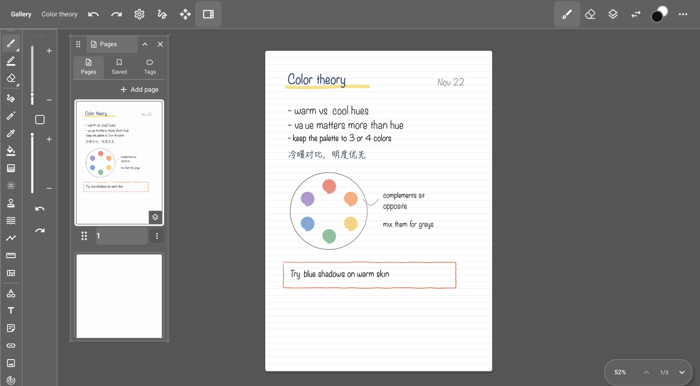
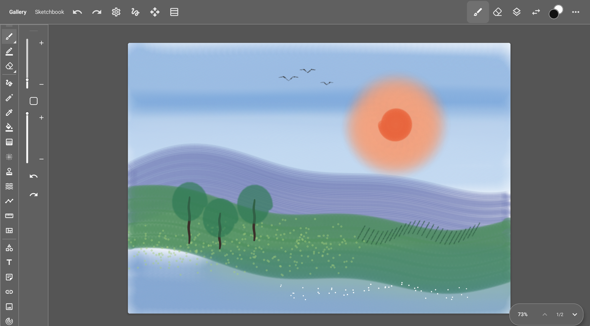

<p align="center">
  
</p>
<h1 align="center">Inkloom</h1>
<p align="center">A handwritten notebook and painting studio for Android pen tablets.</p>
<p align="center">
  
  
  
</p>





---

### Installation

Download the APK from the latest [release](https://github.com/oodadoudou/Inkloom/releases/latest) and open it on your tablet. Android asks once to allow installing from your browser or file manager. After that, Inkloom tells you when a new release is out and installs it for you; you can also skip a version.

To build it yourself, you need JDK 17 and the Android SDK (API 35) with NDK 27.2.12479018 and CMake 3.22.1:

```bash
git clone https://github.com/oodadoudou/Inkloom.git
cd Inkloom
./gradlew installDebug          # installs "Inkloom Debug" beside the released app
```

For a release APK, run `./gradlew assembleRelease`. It is signed with the key in `keystore.properties` (`storeFile`, `storePassword`, `keyAlias`, `keyPassword`), or with the debug key if that file is missing.

### Features

- **Notes**: notebooks and folders; ruled, grid, dot and Cornell paper; page templates, bookmarks and outlines; PDF and image annotation. Search covers typed text, PDF text, images and handwriting, and lassoed handwriting converts to text.
- **Painting**: pressure and tilt with low-latency ink; pens, pencils, watercolor, oil, airbrush and marker brushes, plus brushes imported from Clip Studio Paint (`.sut`), Photoshop (`.abr`) and Procreate (`.brush`, `.brushset`); blending, smudge and liquify; selections and transforms; layers with masks, clipping and adjustment layers; filters, rulers, perspective and symmetry.
- **Familiar from day one**: Clip Studio Paint keyboard shortcuts and dockable palettes, Procreate gestures, and PSD, ORA, TIFF, PNG and PDF in and out.
- **Private**: notebooks, brushes and settings stay on the tablet; text recognition and super resolution run on the device. Inkloom goes online only to check GitHub for a new release.

### Gestures

| Gesture | Action |
| --- | --- |
| Two-finger tap | Undo (hold to keep undoing) |
| Three-finger tap | Redo (hold to keep redoing) |
| Touch and hold | Eyedropper |
| Pinch, twist | Zoom, rotate |
| Quick pinch in | Fit to screen |
| Four-finger tap | Full screen |
| Three-finger scrub | Clear layer |
| Draw and hold | Snap to a line or shape |

You can turn each gesture on or off in **Settings > Gestures**. Pen buttons and keyboard shortcuts are set under **Settings > Shortcuts**.

### Development

```bash
./gradlew testDebugUnitTest lintDebug     # unit tests and lint
./gradlew connectedDebugAndroidTest       # instrumented tests, run against the separate "Inkloom Debug" app
./scripts/setup_android15_emulator.sh     # one-time: a local Android 15 tablet emulator
./scripts/start_android15_emulator.sh
```
