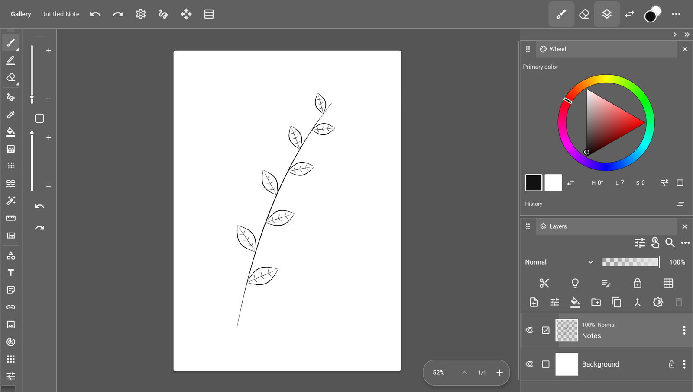

<p align="center">
  
</p>
<h1 align="center">Inkloom</h1>
<p align="center">A painting studio and notebook for Android pen tablets. Fully offline.</p>
<p align="center">
  
  
  
</p>



---

### Installation

Download the latest APK from [Releases](https://github.com/oodadoudou/Inkloom/releases) and open it on your tablet. Android asks once to allow installing from your browser or file manager.

To build it yourself, you need JDK 17 and the Android SDK (API 35):

```bash
git clone https://github.com/oodadoudou/Inkloom.git
cd Inkloom
./gradlew installDebug          # installs on the connected tablet or emulator
```

For a release APK, run `./gradlew assembleRelease`. It is signed with the key in `keystore.properties` (`storeFile`, `storePassword`, `keyAlias`, `keyPassword`), or with the debug key if that file is missing.

### Features

- **Painting**: pressure and tilt with low-latency ink; brushes imported from Clip Studio Paint (`.sut`), Photoshop (`.abr`) and Procreate (`.brush`, `.brushset`); blending, smudge and liquify; selections and transforms; layers with masks, clipping and adjustment layers; filters, rulers, perspective and symmetry.
- **Notes**: notebooks and folders, page templates, PDF and image annotation, bookmarks and outlines. Search covers PDF text, images and handwriting, and lassoed handwriting converts to text.
- **Familiar from day one**: Clip Studio Paint keyboard shortcuts and dockable palettes, Procreate gestures, and PSD, ORA, TIFF, PNG and PDF in and out.
- **Private**: Inkloom has no internet permission. Text recognition and super resolution run on the device.

### Gestures

| Gesture | Action |
| --- | --- |
| Two-finger tap | Undo (hold to keep undoing) |
| Three-finger tap | Redo (hold to keep redoing) |
| Touch and hold | Eyedropper |
| Pinch, twist | Zoom, rotate |
| Quick pinch in | Fit to screen |
| Four-finger tap | Full screen |
| Three-finger scrub | Clear layer |
| Draw and hold | Snap to a line or shape |

You can turn each gesture on or off in **Settings > Gestures**. Pen buttons and keyboard shortcuts are set under **Settings > Shortcuts**.

### Development

```bash
./gradlew testDebugUnitTest lintDebug     # unit tests and lint
./gradlew connectedDebugAndroidTest       # instrumented tests on a device or emulator
./scripts/setup_android15_emulator.sh     # one-time: a local Android 15 tablet emulator
./scripts/start_android15_emulator.sh
```
