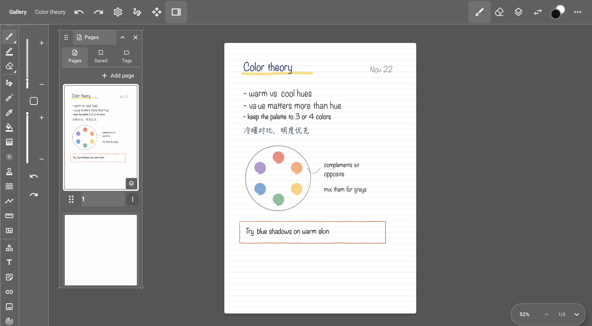
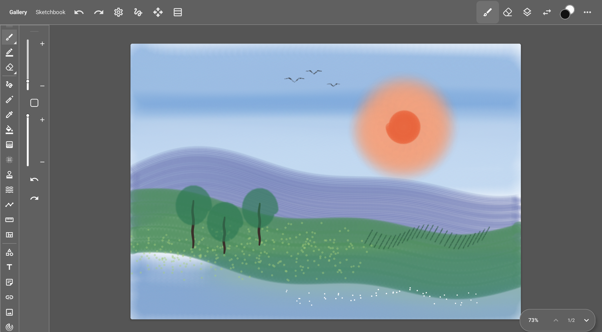

<p align="center">
  
</p>
<h1 align="center">Inkloom</h1>
<p align="center">面向 Android 手写平板的手写笔记本与绘画工作室。</p>
<p align="center">
  
  
  
</p>
<p align="center"><a href="README.md">English</a> · <b>简体中文</b></p>





---

### 安装

从最新的 [Release](https://github.com/oodadoudou/Inkloom/releases/latest) 下载 APK，在平板上打开即可。Android 会询问一次是否允许从浏览器或文件管理器安装应用。之后有新版本时，Inkloom 会提示你并自动完成安装；也可以跳过某个版本。

自行构建需要 JDK 17，以及带 NDK 27.2.12479018 和 CMake 3.22.1 的 Android SDK（API 35）：

```bash
git clone https://github.com/oodadoudou/Inkloom.git
cd Inkloom
./gradlew installDebug          # 安装“Inkloom Debug”，与正式版并存
```

构建正式版 APK 请运行 `./gradlew assembleRelease`。它使用 `keystore.properties` 中的密钥签名（`storeFile`、`storePassword`、`keyAlias`、`keyPassword`）；没有该文件时使用调试密钥。

### 功能

- **笔记**：笔记本与文件夹；横线、方格、点阵和康奈尔纸；页面模板、书签与大纲；PDF 与图片批注。搜索覆盖输入的文字、PDF 文字、图片和手写内容，圈选的手写可以转成文字。
- **绘画**：支持压感与倾斜，低延迟笔迹；钢笔、铅笔、水彩、油画、喷枪和马克笔笔刷，并可导入 Clip Studio Paint（`.sut`）、Photoshop（`.abr`）和 Procreate（`.brush`、`.brushset`）笔刷；混色、涂抹与液化；选区与变换；带蒙版、剪贴和调整图层的图层系统；滤镜、尺规、透视与对称。
- **上手即熟悉**：Clip Studio Paint 的快捷键与可停靠面板、Procreate 的手势，以及 PSD、ORA、TIFF、PNG 和 PDF 的导入导出。
- **隐私**：笔记、笔刷和设置都保存在平板上；文字识别与超分辨率在本机运行。Inkloom 只在检查 GitHub 新版本时联网。

### 手势

| 手势 | 操作 |
| --- | --- |
| 双指轻点 | 撤销（按住可连续撤销） |
| 三指轻点 | 重做（按住可连续重做） |
| 长按 | 吸管取色 |
| 双指捏合、旋转 | 缩放、旋转画布 |
| 快速向内捏合 | 适应屏幕 |
| 四指轻点 | 全屏 |
| 三指来回擦 | 清空图层 |
| 画完停住 | 吸附为直线或形状 |

每个手势都可以在 **设置 > 手势** 中单独开关。笔按键和键盘快捷键在 **设置 > 快捷键** 中设置。

### 开发

```bash
./gradlew testDebugUnitTest lintDebug     # 单元测试与 lint
./gradlew connectedDebugAndroidTest       # 仪器测试，在独立的“Inkloom Debug”应用上运行
./scripts/setup_android15_emulator.sh     # 仅需一次：创建本地 Android 15 平板模拟器
./scripts/start_android15_emulator.sh
```
